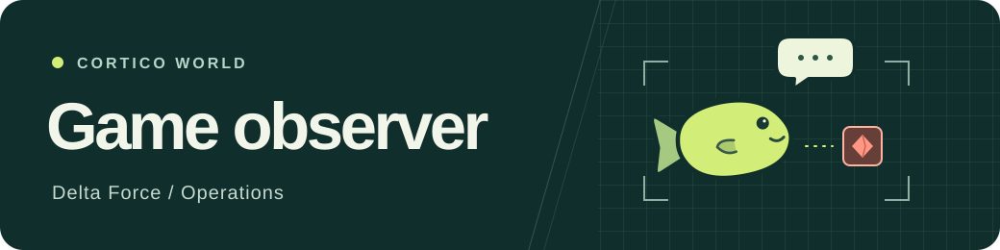

<p align="center">
  
</p>

<h1 align="center">Game observer</h1>
<p align="center">Bring Coo along on your next Delta Force Operations raid.</p>
<p align="center"><a href="README.md" lang="zh-CN">简体中文</a> · English</p>
<p align="center"><code>0.1.15</code> · <code>Windows</code> · <code>Cortico World API 6</code> · <a href="LICENSE">AGPL-3.0-or-later</a></p>

Game observer watches the monitor you select, reads combat notifications with Windows OCR and looks for red-tier loot candidates in inventory and container grids. Coo can react to an event with its screenshot and your own game notes. Your pet can stay on one monitor while you play on another.

## Host compatibility

**Observation requires a Coopanion host that implements the game observer binding.** Screen capture and calibration have been verified on the customized Windows build of **Coopanion 0.2.22 with Cortico 0.2.17**. This repository distributes the World plugin.

The stock 0.2.22 host loaded the previous 0.1.14 panel during testing, but the World remained unbound and capture was unavailable. Inspection of stock 0.2.23 found no equivalent binding in its World loader. That version still needs a runtime test. [Host loader](https://github.com/Pal-AI-Lab/Coopanion/blob/v0.2.23/core/companion.ts) · [World binding interface](src/protocol.ts)

## Install

Choose **Code → Download ZIP** on GitHub and extract it, or clone the repository with Git.

```powershell
git clone https://github.com/kyrsi/cortico-world-delta.git
```

In the compatible host, open **Settings → Extensions** and install from the local directory containing `package.json`, `describe.json` and `dist`. The compiled plugin is included. Keep that folder in place. Restart Coopanion, activate the World in advanced mode, then open its observer panel.

## First raid

1. In the host’s computer-use settings, enable screen viewing and game observation. Select the gaming monitor and check its preview. Choose a policy that permits continuous viewing. Keyboard and mouse control can stay off. Install the Windows OCR language for the game text you want to read.
2. Enter your full in-game nickname under combat recognition. Set the game aspect ratio under observation and calibration. The default is **16:10**.
3. With the Chinese solo or squad preparation screen visible, press <kbd>Ctrl</kbd> + <kbd>Shift</kbd> + <kbd>F8</kbd>. Review the estimated regions in the panel and confirm within 60 seconds. To measure the loot region on the current frame, repeat with the entire safe-box title and grid visible. The panel button also gives you three seconds to switch back to the game.
4. Enable the detectors you want and start observation. Recent events distinguish kills from knockdowns and record self, teammate or unknown attribution. Red-tier candidates still need visual confirmation. The calibration workflow was replayed on 16:9 and 16:10 imagery. Native 4:3 remains unverified.

## Reactions and game notes

By default, eligible events have a 50% chance of waking Coo, with at least 45 seconds between ordinary game wakeups. Change the cooldown and eligible events in the panel. OCR runs locally. Event screenshots can reach the model provider configured in Coopanion when Coo responds.

Import a UTF-8 Markdown file under game knowledge to give Coo phrases or context for specific events. Use headings such as `## [kill] Kills` and `## [loot] Loot`. Reimport a file after editing it. [Built-in knowledge file](knowledge/delta-operations.md)

To end a session, stop observation. To uninstall, deactivate the World, remove it in Extensions and restart Coopanion.

## Development

Use Node.js 22 or later to rebuild the extension from the repository root.

```powershell
npm ci
npm run build
```

A community extension for [Coopanion](https://github.com/Pal-AI-Lab/Coopanion), built on [Cortico](https://github.com/Pal-AI-Lab/Cortico). [License](LICENSE)
