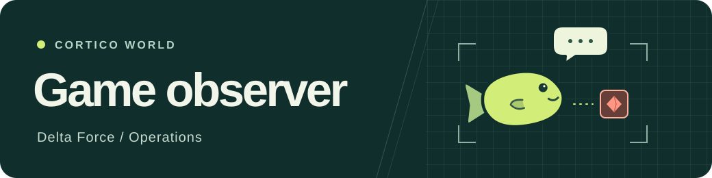

<p align="center">
  
</p>

<h1 align="center">三角洲观察</h1>
<p align="center">你打《三角洲行动》烽火地带，Coo 陪你看击杀栏，也陪你翻背包。</p>
<p align="center">简体中文 · <a href="README.en.md" lang="en">English</a></p>
<p align="center"><code>0.1.15</code> · <code>Windows</code> · <code>Cortico World API 6</code> · <a href="LICENSE">AGPL-3.0-or-later</a></p>
<p align="center"><a href="#宿主兼容性">宿主兼容性</a>　·　<a href="#安装">安装</a>　·　<a href="#第一次观察">第一次观察</a>　·　<a href="#让-coo-怎么说">回应设置</a>　·　<a href="#开发">开发</a></p>

**Game observer** 是一个可独立安装的 Coopanion World 扩展。它在后台查看你选定的显示器，用本机的 Windows OCR 读取战斗提示，在背包、搜刮或容器画面中寻找红色物品格。事件附带当时的画面，Coo 可以沿用自己的口吻接一句。游戏在屏幕 2 时，桌宠和气泡可以留在原来的位置。

## 宿主兼容性

**完整观察功能已在接入三角洲观察接口的定制版 Coopanion 0.2.22（Cortico 0.2.17）上验证。** 这个仓库只分发插件。安装前请确认你的宿主能为此 World 提供屏幕采集和持续查看权限。

- **官方 Coopanion 0.2.22** 在隔离实测中可以加载上一版 0.1.14 的管理面板，观察状态显示「尚未连接应用」，采集和一键校准不可用。
- **官方 Coopanion 0.2.23** 的 World 加载源码中仍未发现该接入。此版本尚待装机验证。使用官方原版时，单独安装插件不能补上宿主接口。[官方加载源码](https://github.com/Pal-AI-Lab/Coopanion/blob/v0.2.23/core/companion.ts) · [扩展接口定义](src/protocol.ts)

## 安装

1. 在本仓库的 **Code → Download ZIP** 下载并解压到长期保留的目录，或用 Git 克隆仓库。

   ```powershell
   git clone https://github.com/kyrsi/cortico-world-delta.git
   ```

2. 打开兼容宿主的「设置 → 扩展」，选择**从本地安装**。选中同时包含 `package.json`、`describe.json` 和 `dist` 的那一层目录。仓库已包含构建产物。
3. 按提示重启 Coopanion，在高级模式激活「三角洲观察」World，打开「三角洲观察 → 运行状态」。本地安装会引用所选目录，请保留它。

## 第一次观察

1. **选屏。** 在「习惯 → 电脑操作」开启屏幕查看和「游戏观察」，选择游戏所在的显示器，通过预览核对画面。持续观察需要允许免逐轮确认的查看权限，鼠标键盘控制可保持关闭。中文游戏界面需要 Windows 已安装中文 OCR。
2. **填写昵称与比例。** 在「三角洲观察 → 配置 → 战斗识别」填写你自己的完整游戏昵称，用于判断击杀归属。在「观察与校准」选游戏内的画面比例，默认 **16:10**。
3. **校准。** 进入中文单人或组队准备页，按 <kbd>Ctrl</kbd> + <kbd>Shift</kbd> + <kbd>F8</kbd>，或点击「一键校准」后在 3 秒内切回游戏。准备页可估算战斗和物品区域。要精确定位安全箱，打开背包，露出安全箱标题和完整物品格，再校准一次。回到「运行状态」，在 60 秒内核对截图、时间和选区，再确认保存。
4. **开始观察。** 在「配置」中启用需要的战斗或物品识别，点击「开始观察」，即可从开局持续运行。「最近事件」能看到击杀、击倒和出红候选的记录，以及是否触发了回应。

**战斗识别**区分本人、队友与归属未确认的动作。个人战斗反馈可以帮助确认本人击杀，协助与观战有独立标记。**出红识别**寻找红色品质物品候选，名称、价值、是否拾取仍需结合截图判断。

准备页与安全箱定位已用 16:9、16:10 画面回放验证。4:3 目前覆盖合成的黑边和拉伸样本，原生 4:3 仍待复核。若自动选区与画面不符，可以手动框选。想复制漏判画面，可在截图预览上右键选择「打开文件所在位置」。

## 让 Coo 怎么说

默认以 **50% 概率**为本人击杀、击倒和物品候选唤醒 Coo，普通游戏唤醒之间至少间隔 **45 秒**。队友和归属未确认的动作也会保留在事件记录中，可以单独加入回应范围。文字识别在本机完成。触发回应时，事件截图可随对话发送至你在 Coopanion 配置的模型服务。

在「运行状态 → 游戏知识」可导入 UTF-8 Markdown。按事件写下想让 Coo 参考的用语，它会继续使用原有 Persona。

```markdown
## [kill] 击杀
看到明确的本人击杀时，可以简短庆祝。

## [loot] 搜刮
红色物品格出现时先跟着高兴，只有看清名称才点名。
```

修改原文件后需重新导入。「游戏回应」可调节回应概率、间隔和玩梗程度。[随包知识文件](knowledge/delta-operations.md)

## 停止与卸载

临时结束采集时点「停止观察」。卸载时先在高级模式停用这个 World，再到「扩展」卸载并重启。同一部署内重新安装后可读回保存的配置和导入知识。

## 开发

仓库包含 World 源码、Windows 识别进程、设置面板、知识文件和预构建产物。修改源码后，在仓库根目录重新构建，再在兼容宿主中重新加载扩展。

```powershell
npm ci
npm run build
```

本项目是为 Coopanion 编写的社区扩展。[Coopanion](https://github.com/Pal-AI-Lab/Coopanion) · [Cortico](https://github.com/Pal-AI-Lab/Cortico) · [许可证](LICENSE)
